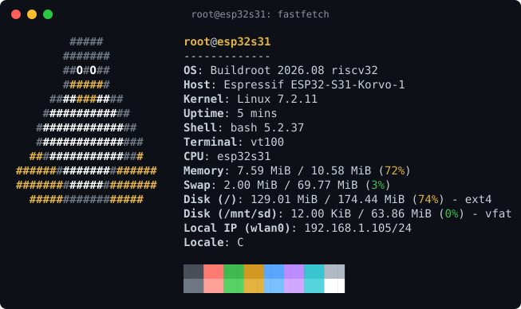

# ESP32-S31 Linux

Linux 7.3 and OpenSBI 1.9 on the ESP32-S31: on the ESP32-S31-Korvo-1 board,
and on the ESP32-S31-WROOM-3-N16R16V module alone (the module of the Korvo-1).
Linux uses the 16 MiB octal PSRAM as its memory.

```text
ESP ROM -> ESP-IDF 2nd stage -> loader -> OpenSBI -> Linux -> Buildroot root (card or flash)
```



## About

The ESP32-S31 is a microcontroller: two RV32 harts at 320 MHz, 512 KiB of
SRAM, Wi-Fi 6 and Bluetooth. It was not made for Linux. This project runs a
stock Linux 7.3 kernel with a small patch set on it, with a real userspace:
a shell on the LCD, Wi-Fi with `wpa_supplicant`, Bluetooth with BlueZ, SSH,
USB keyboards and sticks, `vim`, `gdb`, `strace`, MicroPython and a text-mode web browser
(`links`).

You can use it in two ways:

- **To try it.** Flash a release, write the card image (Korvo-1 only), and
  log in. It takes about ten minutes.
- **To learn from it.** The SoC has no PLIC, no Zicbom and no coherent DMA.
  Each of these has a solution here that you can read in a few hundred
  lines. [docs/internals.md](docs/internals.md)
  tells the full story for kernel developers.

## Boards

There are two builds. Select one with `BOARD` for each `make` target. The
Korvo-1 has a card with much space, so it gets the full set of tools. The
module alone has only its 16 MB flash, so it gets a small set. The two
builds share one base configuration
(`br2-external/board/esp32s31/defconfig/common.fragment`): the kernel, the
toolchain, BusyBox, Dropbear, OpenSSL, `wpa_supplicant`, curl, iperf3,
libgpiod and BlueZ. Each board fragment adds only its own parts.

| | `korvo1` (the default) | `esp32s31` |
| --- | --- | --- |
| Hardware | ESP32-S31-Korvo-1, with the ESP32-S31-WROOM-3-N16R16V | The ESP32-S31-WROOM-3-N16R16V alone (16 MB flash, 16 MB PSRAM), on any board with UART0 |
| Root | ext4 on the microSD card | squashfs in the flash, with a writable UBIFS overlay (see [Flash root](#flash-root-esp32s31)) |
| Persistence | All files on the card | All files: the overlay is in the flash |
| Swap | zram (6 MiB), then 64 MiB on p3 of the card | zram (6 MiB) only |
| Consoles | UART, and the LCD with a USB keyboard | UART |
| Hardware for Linux | LCD, microSD, USB host, RGB LED, GPIO, RNG | GPIO, RNG |
| Wi-Fi and Bluetooth | `wlan0` and `hci0`, WPA2 and WPA3, Personal and Enterprise, AP with `hostapd`, BlueZ with its classic tools | `wlan0` and `hci0`, WPA2 and WPA3, Personal and Enterprise, AP with `wpa_supplicant`, BlueZ (`bluetoothd`, `bluetoothctl`) |
| RAM for Linux | 10.8 MiB | 12.6 MiB |
| Userspace | bash, vim, gdb, strace, MicroPython, Lua, links, curl, tcpdump, htop and more | BusyBox, Dropbear, wpa_supplicant, iw, curl, bluetoothctl, iperf3, the GPIO tools, flash_erase |

## Try it

1. Get the files of your board from the newest release on the
   [releases page](https://github.com/annoyedmilk/esp32-s31-linux/releases):
   `*-korvo1-flash.zip` and `*-korvo1-sdcard.img.xz` for the Korvo-1, or
   `*-esp32s31-flash.zip` for the ESP32-S31-WROOM-3-N16R16V alone.
2. Flash: `pip install "esptool==5.5.0"` (the tested version, in
   `bootloader/esptool.version`), connect the UART port, then
   `esptool --chip esp32s31 -p PORT -b 921600 write-flash 0x0 flash.bin`.
3. Korvo-1 only: write `*-sdcard.img.xz` to a microSD card (for example
   with balenaEtcher), and put the card into the board.
4. Open the console on the UART port at 115200 baud. Push reset. When the
   console shows `=== ESP32-S31 Linux / Buildroot ===`, you are root.
5. Connect to Wi-Fi (see [Wi-Fi](#wi-fi)), then try `ssh` or `iperf3`.

The consoles log in as root. SSH takes root only with a key: add your
public key to `/root/.ssh/authorized_keys` from the console first.

## What works

On the two boards:

- UART console (`ttyS0`), on the CP2102N bridge of the Korvo-1.
- Wi-Fi as `wlan0` (cfg80211 full-MAC) through the ESP-Hosted firmware on
  hart 0: station, and access point with `wpa_supplicant` (`mode=2`). WPA2
  and WPA3-SAE, Personal and Enterprise (PEAP, TTLS, TLS). The release notes
  give the iperf3 throughput of each release.
- Bluetooth as `hci0` through the same firmware: BR/EDR and LE. BlueZ:
  `bluetoothd` and `bluetoothctl`, LE scan and BR/EDR inquiry.
- HTTPS with `curl`, which verifies certificates against the CA bundle.
- Hardware RNG, GPIO, swap to zram, `reboot`, and `poweroff` into deep sleep.

On the Korvo-1 also:

- 800x480 LCD as `/dev/fb0` with `fbcon`, and a login on `tty1`.
- USB host (DWC2): keyboards, mice, `hidraw` and mass storage.
- microSD (`dw_mmc` with internal DMA): FAT on p1, ext4 root on p2, swap
  on p3.
- An access point with `hostapd`.
- The classic BlueZ tools (`hciconfig`, `hcitool`), and pairing with
  Secure Simple Pairing.
- The RGB LED as `/sys/class/leds/rgb:status`.

## Tested hardware

Espressif makes new chip revisions, and a different revision can change
the behavior. This port is tested only on this board, with the two builds:

| Item | Value |
| --- | --- |
| Board | ESP32-S31-Korvo-1 |
| Chip | ESP32-S31, revision v0.0 (wafer major 0, minor 0) |
| Package version (eFuse) | 0 |
| eFuse block version | 0.0 |
| PSRAM (eFuse vendor 1, capacity 1) | 16 MiB octal |
| Flash | 16 MB NOR (JEDEC manufacturer 0x46, device 0x4018) |
| Crystal | 40 MHz |

To read these values from your board:

```sh
python -m esptool --chip esp32s31 -p PORT chip-id
python -m esptool --chip esp32s31 -p PORT flash-id
python -m espefuse --chip esp32s31 -p PORT summary
```

## Design

- **Harts.** Hart 0 stays in M-mode. It runs the ESP-IDF loader, which stays
  resident as the radio firmware. Linux runs on hart 1 only.
- **Loader.** The loader checks the size and CRC of the kernel. It copies the
  kernel to `0x50000000` and OpenSBI to `0x50F00000`. It starts Wi-Fi and Bluetooth,
  and on the Korvo-1 also the LCD, the SD slot and the LED. Then it releases
  hart 1 into OpenSBI, and locks hart 0 out of PSRAM with PMP.
- **Interrupts.** OpenSBI gives the CLIC inputs to S-mode. If an input is not
  in S-mode, Linux cannot see it. The S-mode trampoline must use `sret` and
  restore `scause.spil`. `mret` locks `mintstatus.SIL` and masks all
  supervisor interrupts.
- **Cache.** PSRAM is write-back. The panel DMA reads the frame buffer from
  PSRAM without the cache, so OpenSBI makes the frame buffer range uncached
  with PMA entries. No bus master is coherent with the data cache, and the
  hart has no Zicbom. DMA uses the cache sync engine, which OpenSBI programs
  for Linux through a vendor SBI extension
  (`drivers/cache/esp32s31-cache.c`). The I-cache refills from PSRAM, not
  from the D-cache, so Linux writes the D-cache back before each `fence.i`.
  Coherent DMA memory comes from a 64 KiB pool in SRAM at `0x2F040000`.
- **Shared SRAM.** `0x2F040000`-`0x2F05D000` is outside the ESP-IDF heap:
  the DMA pool, then the ESP-Hosted rings at `0x2F050000`
  (`shared/esp32s31-hosted-shm.h`).
- **Display (Korvo-1).** The frame buffer is at `0x50F40000`. The loader DMA
  continues to scan it out after the handoff. Linux uses it as a
  `simple-framebuffer`. The esp32s31 board has no frame buffer, and Linux
  gets the 768 KiB.

## Hardware connections (Korvo-1)

| Connector | Use |
| --- | --- |
| Power Type-C | Power only. |
| UART Type-C | CP2102N to UART0: flash and Linux console (`/dev/cu.usbserial-*`). |
| USB Type-A | USB 2.0 host for Linux. |
| GPIO33/34 breakout | Native USB Serial/JTAG (`/dev/cu.usbmodem*`): D- white to GPIO33, D+ green to GPIO34, GND black. Do not connect 5 V. |

GPIO33/34 are also LCD data pins. You can use the LCD or JTAG, not both. The
default is the LCD (`CONFIG_ESP_CONSOLE_SECONDARY_NONE` in
`bootloader/sdkconfig.defaults.korvo1`). For JTAG, set
`CONFIG_ESP_CONSOLE_SECONDARY_USB_SERIAL_JTAG=y` instead. The esp32s31
board always gives GPIO33/34 to the USB Serial/JTAG.

## Host requirements

- macOS with Homebrew and GNU make (`brew install make`).
- ESP-IDF at `~/esp/esp-idf`, at the commit in `bootloader/esp-idf.version`,
  with the `riscv32-esp-elf` toolchain and the ESP-Hosted patches
  (`make bootloader` gives the command).
- esptool at the version in `bootloader/esptool.version`, in the Python
  environment of ESP-IDF (`make check` gives the command). Move both pins
  together, and test a `make flash` and a boot on the board.
- Apple `container` CLI. Run `container system start` first.

On Linux, `scripts/ci-build.sh` builds everything without a container.

Buildroot does not run on macOS. It runs in the Debian image from
`container/Containerfile`, with 6 GB of memory (`BR_MEMORY`) and 5 jobs
(`BR_JOBS`). The output of each board (`/br/<board>`), the downloads
(`/br/dl`) and the ccache are in the `esp32s31-br` volume.

```sh
git submodule update --init --recursive
make container-image
make check
make ports
```

## Build, flash and monitor

```sh
make build
make flash   FLASH_PORT=/dev/cu.usbserial-XXXX
make monitor SERIAL_PORT=/dev/cu.usbserial-XXXX
```

- Add `BOARD=esp32s31` for the ESP32-S31-WROOM-3-N16R16V alone. The output of a board goes to
  `build/<board>/`.
- `make build` builds the loader and OpenSBI on the Mac. Buildroot builds the
  kernel, the rootfs and the card images in the container.
- `make monitor` resets the board and waits for
  `=== ESP32-S31 Linux / Buildroot ===`. Then it stays open as a terminal.
  Push `Ctrl-]` to exit. It writes a log to `logs/`.
- Set `RESET_PORT` if the RTS line of `SERIAL_PORT` cannot reset the board.
- Files in `local-overlay/` go into the root of both builds, for example
  `root/.ssh/authorized_keys` and `etc/wpa_supplicant.conf`. git ignores
  them, and `scripts/package-release.sh` stops when the directory has files.
  A file that you remove from it stays in the Buildroot output until a
  clean build.
- Buildroot does not build a package again when only its options change.
  After such a change in a fragment, run `<package>-dirclean` in the
  Buildroot output of the board, or build from a clean volume.
- `make help` shows all targets.

The Korvo-1 kernel mounts `/dev/mmcblk0p2` as the root (`rootwait`).
Without a prepared SD card, it waits for the card.

## SD card (Korvo-1)

The card is MBR. p1 is FAT32 and is mounted on `/mnt/sd`. p2 is the ext4 root
(512 MiB in the card image). p3 is swap (type `0x82`, 64 MiB). All card
targets erase data. They ask for confirmation and `sudo`.

| Command | Use |
| --- | --- |
| `make sdpart SD_DISK=/dev/diskN` | Partition a large card. p1 gets `SD_DATA_SIZE` (28G, at least 4G), p3 64 MB, p2 the rest. |
| `make sdwrite SD_DISK=/dev/diskN` | Write the full card image. Use for a small card. |
| `make sdroot SD_DISK=/dev/diskN` | Write only the root partition. Use for updates. It stops when p2 is smaller than the root image. |

If the root goes read-only, run `e2fsck -f /dev/mmcblk0p2` from the console.

When the board is reset with p1 mounted, the FAT keeps a dirty flag. Linux
does not clear it, also not at a clean shutdown, and warns at each mount.
`S10sdcard` runs `fsck.fat -a` on a dirty p1 before it mounts it.
`fsck.fat` needs approximately 8 bytes of memory for each cluster. That is
less than 1 MB for the 64 MiB p1 of the card image. `make sdpart` formats p1
with 64 KiB clusters: a 28 GiB p1 then needs 3.3 MiB, not the 13 MiB of the
16 KiB clusters that `diskutil` selects. `S10sdcard` skips a p1 whose
clusters do not fit in half of the free memory, for example a card that a
camera formatted: check such a card on the host.

## Userspace

The serial and panel consoles log in as root automatically. Dropbear takes
root only with a key (`-g` in `/etc/default/dropbear`): put the public key
into `/root/.ssh/authorized_keys`. The root password is `korvo-bringup`.

Boot scripts of the two boards, in `br2-external/board/esp32s31/rootfs-overlay`
and the overlay of each board:

- `S01clock` sets the clock from `/etc/timestamp`. The board has no RTC.
- `S05swap` starts 6 MiB of LZ4 swap in RAM (`/dev/zram0`, priority 100).
  Then, when the MBR gives p3 the type `0x82`, it formats p3 and swaps to
  it at priority 10. The kernel uses the card only when zram is full. A
  card without such a p3 swaps to zram only.
- `/etc/sysctl.d/10-reserve.conf` keeps 512 KiB free for the zram writes.
  A larger reserve takes memory from the page cache.
- `S10sdcard` mounts p1 on `/mnt/sd`.
- `S40wifi` starts `wpa_supplicant` on `wlan0` in the background, so that
  the console does not wait for it. `S40wifi restart` waits. `S40bluetoothd`
  starts BlueZ for `hci0`.
- The udhcpc hook sets the clock with NTP on each new lease.
- `S95autostart` runs `/mnt/sd/autostart.sh`, or `/root/autostart.sh`
  when the card has none.
- `S99banner` prints the line that `make monitor` waits for.
- The module alone also has `overlay-init` and `S00overlay` (see
  [Flash root](#flash-root-esp32s31)).

`login` and SSH show `/etc/motd`, which lists the first commands.

The esp32s31 board has only the BusyBox tools and the programs in
[Boards](#boards). The tools below are for the Korvo-1.

### Tools

| Use | Commands |
| --- | --- |
| System | `htop`, `free`, `df -h`, `dmesg`, `file`, `strace`, `gdbserver` |
| Network | `ssh`, `scp`, `curl`, `links`, `iperf3`, `tcpdump`, `nslookup` |
| Code | `micropython`, `lua`, `vim` |
| Hardware | `gpioinfo`, `gpioget`, `gpioset` (libgpiod 2), `lsusb` |

The shell is bash, with a history that stays after a reset.

### Flash root (esp32s31)

The ESP32-S31-WROOM-3-N16R16V alone has no card. Its root is in the flash,
as in OpenWrt: a read-only squashfs on `/dev/mtdblock0` (`rootfs`, 7.5 MiB),
and UBIFS on the `data` partition (`/dev/mtd1`, 2.4 MiB) as a writable
overlay over it. `/sbin/overlay-init` mounts the two, then starts init. So all of `/`
is writable, and each change stays: `/etc/wpa_supplicant.conf`, the SSH
host keys, `/root/.ssh` and your own files. The squashfs is at `/rom`, the
data partition at `/overlay`.

```sh
mtdinfo -a                 # the two partitions
df -h /overlay             # free space in the overlay
flash_erase /dev/mtd1 0 0  # then reboot: back to the image
```

Linux cannot drive the SPI flash itself: hart 0 runs its code from it.
Linux reads the partitions through the flash cache, where the firmware on
hart 0 maps them. The firmware programs and erases the flash for Linux
with flash auto-suspend, so Linux runs on while it does.
`make flash` and `flash.bin` do not write `data`, so the overlay stays
after an update. After a change of the partition layout, erase `data`
(for example `esptool erase-region` with its offset and size), so that UBI
formats it again.

The squashfs is zstd at the highest level that Buildroot gives, with
32 KiB blocks: gzip does not fit with BlueZ, and xz decompresses too
slowly. The cost is time: each page fault of a program decompresses one
block. `make` stops when the image is larger than the `rootfs` partition.

### Files and scripts

- **Copy files.** From a computer, `scp` and `sftp` work with the key in
  `/root/.ssh/authorized_keys`: `scp file root@<address>:/mnt/sd/`.
- **Web server.** `httpd -f -p 8080 -h /mnt/sd` gives the files of the card
  to a browser, at `http://<address>:8080/<file name>`. It shows no list of
  the files: a directory needs an `index.html`. Stop it with Ctrl-C.
- **Start at boot.** The board runs `/mnt/sd/autostart.sh` at each boot, as
  root. The file is on the FAT partition, so a computer can also write it,
  and it stays after `make sdroot`.
- **Examples** in `/usr/share/examples`: `led.py` sets the RGB LED from
  MicroPython, `gpio.sh` reads or sets a pin, `www/` is a web page with a CGI
  script for the LED, and `autostart.sh` is a start script.

## Wi-Fi

`wlan0` works with the standard `wpa_supplicant`. `S40wifi` starts it with
`/etc/wpa_supplicant.conf`, or with `wpa_supplicant.conf` on p1 when that
file exists. `make sdroot` does not delete p1, and a board without a console
can get its network from that file. At each connection, the `wpa_cli` action
script starts or renews the DHCP lease.

```sh
wpa_passphrase "<ssid>" "<passphrase>" >> /etc/wpa_supplicant.conf
/etc/init.d/S40wifi restart
wpa_cli status
wpa_cli scan; wpa_cli scan_results
```

For WPA3 and WPA2/WPA3 networks, the network block needs
`key_mgmt=WPA-PSK SAE`, `ieee80211w=1` and the passphrase as `psk="..."`.
The hex PSK from `wpa_passphrase` is not sufficient for SAE. For WPA3 only,
use `key_mgmt=SAE` with `ieee80211w=2`. Keep the default `sae_pwe=0`: with
`sae_pwe=2`, an access point that answers without H2E is not accepted.

For WPA2-Enterprise (for example eduroam), `wpa_supplicant` has PEAP,
TTLS and TLS, with MSCHAPv2, GTC and MD5 inside. The other EAP methods,
DPP, P2P and TDLS are not built, for flash.

The default configuration has `pmf=1`: protected management frames when
the access point offers them. Without them, a WPA2/WPA3 router gave less
than half of the TX throughput.

On the esp32s31 board, the network stays in the overlay.

For an access point on the two boards, stop `S40wifi` and start
`wpa_supplicant -B -D nl80211 -i wlan0 -c /tmp/ap.conf` with a network
block that has `mode=2`, for example `ssid="esp32s31"`, `mode=2`,
`frequency=2437`, `key_mgmt=WPA-PSK`, `proto=RSN`, `pairwise=CCMP`,
`group=CCMP` and `psk="..."`. The Korvo-1 also has `hostapd`.

The ESP-Hosted firmware on hart 0 runs the 802.11 MAC. The ESP-Hosted host
driver (`esp32_shm`) is built into the kernel. `wpa_supplicant` runs the
authentication and the key handshakes, and logs to syslog
(`/var/log/messages`). `hostapd` with the nl80211 driver starts an access
point on the Korvo-1. Stop `S40wifi` first: `wlan0` is a station or an
access point, not the two at the same time.

## Kernel

Buildroot builds a stock kernel release (`BR2_LINUX_KERNEL_CUSTOM_VERSION_VALUE`
in `br2-external/board/esp32s31/defconfig/common.fragment`) with
`linux/patches/`.

- `0000-esp32s31-add-source-files.patch` is generated from the new files
  under `linux/`. Edit those files, not the patch. Each
  `make kernel`, `make rootfs` and `make kernel-patches` makes the patch
  again, and an edit of the patch is lost.
- `0001` and higher are manual patches to existing kernel files.
- The ESP-Hosted host driver comes from `external/esp-hosted-linux`, with the
  patches in `br2-external/package/esp-hosted-linux/`. A Buildroot linux
  extension (`br2-external/linux/`) copies it into the kernel tree.
- The kernel config is `br2-external/board/esp32s31/linux.config`. Use
  `make kernel-menuconfig` and `make kernel-saveconfig`. The esp32s31 board
  adds `linux-esp32s31.fragment`, which turns off the parts of the Korvo-1.
  Buildroot cannot save a config with a fragment, so change the fragment by
  hand.
- The device tree of each board is built into the kernel:
  `esp32s31_korvo1.dts` or `esp32s31.dts`.
- `make kernel-check` applies the series at zero fuzz with GNU patch.
- `make kernel` and `make rootfs` find a changed series or config. Then
  they extract and patch the kernel again. `make kernel-clean` does this by
  hand.

## Flash layout

| Korvo-1 | esp32s31 | Contents |
| ---: | ---: | --- |
| `0x002000` | `0x002000` | ESP-IDF second-stage bootloader |
| `0x008000` | `0x008000` | Partition table |
| `0x011000` | `0x009000` | NVS |
| `0x019000` | `0x00F000` | PHY calibration data |
| `0x220000` | `0x010000` | OpenSBI `fw_jump` (512 KiB, 256 KiB) |
| `0x020000` | `0x050000` | Loader and radio firmware (2 MiB, 1.75 MiB) |
| `0x2A0000` | `0x210000` | Linux Image with built-in DTB (7.5 MiB, 4 MiB) |
| `0xA1FFF4` | `0x60FFF4` | Linux size and CRC manifest, at the end of the kernel partition |
| | `0x610000` | squashfs root `rootfs` (7.5 MiB) |
| | `0xD90000` | UBIFS overlay `data` (2.4375 MiB, to the end of the flash) |

The partition tables are `bootloader/partitions-<board>.csv`. The Makefile
takes all offsets from them.

## Debugging

1. Set the loader to JTAG (see above). The LCD then stays dark.
2. Run `make flash`, then `make openocd`. It attaches to the running
   board without a reset.
3. Connect `riscv32-esp-elf-gdb` to port 3333. Use `build/korvo1/opensbi.elf`,
   `build/korvo1/bootloader/s31-linux-loader.elf` or `build/korvo1/vmlinux`
   (`make kernel-vmlinux`). GDB shows only the hart of the connection
   (hart 0). Read hart 1 on the OpenOCD telnet port 4444:
   `targets esp32s31.hp.cpu1`, then `reg pc` or `reg mepc`.

## Limits

- Linux is uniprocessor on hart 1.
- The hardware FPU is not used: the hart has F but not D, and Linux supports
  an FPU only with D. Floating point works, because userspace is built
  soft-float (ilp32), but it is slower.
- OpenSBI protects its memory and the TEE/APM registers from S-mode with
  PMP, and its memory from DMA with HP_APM. The radio firmware on hart 0
  runs in M-mode. After it starts hart 1, it locks itself out of PSRAM and
  the DMA pool with PMP.
- `poweroff` puts the chip into deep sleep. Only the reset button starts
  it again. The board itself stays powered.
- The coherent DMA pool is 64 KiB.
- There is no I2C, audio or camera driver.
- The firmware heap is small: see "Internal SRAM" in
  [docs/internals.md](docs/internals.md).
- With WPA3-SAE, the first connection can fail: SAE on hart 1 can take
  longer than the closed Wi-Fi library on hart 0 waits for the
  authentication. `wpa_supplicant` tries again and connects. WPA2 is not
  affected.
- On the esp32s31 board, a cold program start is slower than on the
  Korvo-1, because the root is zstd-compressed (see
  [Flash root](#flash-root-esp32s31)).
- WPA2/WPA3 Enterprise is not tested.
- The access point mode is tested up to the started access point. No
  client has connected to it.
- `hcitool lescan` fails with "Set scan parameters failed". The controller
  is Bluetooth 6.0, and after the kernel used the extended scan commands,
  it rejects the legacy ones that `hcitool` sends (Command Disallowed). Use
  `bluetoothctl` and `scan le`.

## License

`LICENSE` (MIT) applies to the build system, scripts and rootfs files. Other
files have SPDX headers: `bootloader/` and the OpenSBI platform are
BSD-2-Clause, `bootloader/components/esp_hosted/` is Apache-2.0, `linux/`
and `br2-external/package/esp-hosted-linux/` are GPL-2.0,
`shared/esp32s31-hosted-shm.h` is GPL-2.0 or Apache-2.0.
