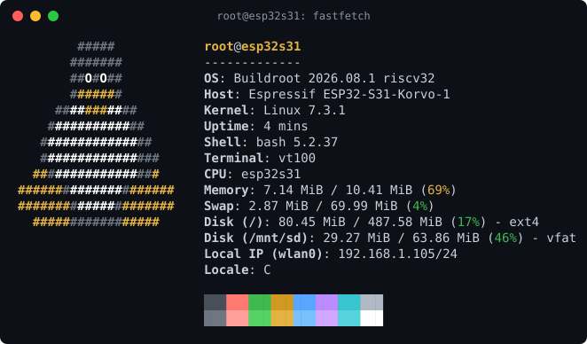

# ESP32-S31 Linux

English | [简体中文](README.zh-CN.md)

Linux 7.3.1 and OpenSBI 1.9 on the Espressif ESP32-S31, a microcontroller
with two RV32 harts at 320 MHz and 512 KiB of SRAM. Linux runs on hart 1
in the 16 MiB octal PSRAM. Hart 0 runs the ESP-Hosted radio firmware for
Wi-Fi, Bluetooth and Thread. A stock kernel with a small patch set boots a
Buildroot userspace: a shell, `wpa_supplicant`, BlueZ, SSH, USB and more.

```text
ESP ROM -> ESP-IDF 2nd stage -> loader (hart 0) -> OpenSBI (hart 1) -> Linux (hart 1)
```



[docs/internals.md](docs/internals.md) tells how the port works and where
the code is. [docs/release-notes.md](docs/release-notes.md) lists the
changes of each release.

## Quick start

There are three builds. The ESP32-S31-WROOM-3-N16R16V module is the module
of the two boards.

| Board | Build | Root | Release files |
| --- | --- | --- | --- |
| ESP32-S31-WROOM-3-N16R16V module alone, on any board with UART0 | `esp32s31` (the default) | flash | `*-esp32s31-flash.zip` |
| ESP32-S31-Function-CoreBoard-1 | `coreboard1` | USB stick | `*-coreboard1-flash.zip`, `*-coreboard1-usb.img.xz` |
| ESP32-S31-Korvo-1 | `korvo1` | microSD card | `*-korvo1-flash.zip`, `*-korvo1-sdcard.img.xz` |

1. Get the files of your board from the newest
   [release](https://github.com/annoyedmilk/esp32-s31-linux/releases).
2. Install the tested esptool: `pip install "esptool==5.5.0"`
   (the version in `bootloader/esptool.version`).
3. Connect the UART port of the board. On the Korvo-1, this is the UART
   Type-C port. The USB bridge is a CP2102N on the Korvo-1 and the
   Function-CoreBoard-1. Some Function-CoreBoard-1 boards have a CH9102X.
4. Flash: `esptool --chip esp32s31 -p PORT -b 921600 write-flash 0x0 flash.bin`
5. Write the disk image, for example with balenaEtcher. All data on the
   disk is lost. Korvo-1: write `*-korvo1-sdcard.img.xz` to a microSD card.
   Function-CoreBoard-1: write `*-coreboard1-usb.img.xz` to a USB stick.
   Put the disk into the board. The module alone needs no disk.
6. Open a terminal on the same port at 115200 baud. Push reset. When the
   console shows `=== ESP32-S31 Linux / Buildroot ===`, you are root.

On the Korvo-1, the LCD also shows a console. Connect a USB keyboard and
log in on `tty1`: it starts a `tmux` desktop.

### Wi-Fi

```sh
wpa_passphrase "<ssid>" "<passphrase>" >> /etc/wpa_supplicant.conf
/etc/init.d/S40wifi restart
wpa_cli status
```

For WPA3 and WPA2/WPA3 networks, the network block needs
`key_mgmt=WPA-PSK SAE`, `ieee80211w=1` and the passphrase as `psk="..."`.
The configuration stays after a reboot. `S40wifi` also reads
`wpa_supplicant.conf` from p1 of the disk (the FAT partition), so a board
without a console can get its network from a computer.

### SSH

The consoles log in as root. Dropbear takes root over SSH only with a key.
On the console of the board, add your public key (one line):

```sh
mkdir -p /root/.ssh && chmod 700 /root/.ssh && echo 'ssh-ed25519 AAAA... you@host' >> /root/.ssh/authorized_keys && chmod 600 /root/.ssh/authorized_keys && sync
```

Read the address with `ip -4 addr show wlan0` (`eth0` on the
Function-CoreBoard-1 with a cable), then `ssh root@<address>`, or use
`ssh root@esp32s31.local` (mDNS). To check the
host key, run `dropbearkey -y -f /etc/dropbear/dropbear_ed25519_host_key |
tail -1` on the console. A new disk image or `make sdroot` gives the board a
new host key and no `authorized_keys`; then run `ssh-keygen -R <address>`
on your computer. For your own builds, put the key into
`local-overlay/root/.ssh/authorized_keys`.

## Features

| Feature | `esp32s31` | `coreboard1` | `korvo1` |
| --- | --- | --- | --- |
| Root | squashfs in the flash, with a writable UBIFS overlay | ext4 on the USB stick | ext4 on the microSD card |
| Persistence | All files: the overlay is in the flash | All files on the stick | All files on the card |
| Swap | zram (6 MiB) | zram, then 64 MiB on p3 of the stick | zram, then 64 MiB on p3 of the card |
| RAM for Linux (MemTotal) | about 11.6 MiB | about 11.1 MiB | 10.4 MiB |
| UART console (`ttyS0`), 9767 baud to 5 Mbaud with `stty` | yes | yes | yes |
| Copy of the boot log and JTAG on the native USB port | yes | yes | no: the LCD uses the pins |
| LCD console, USB keyboard, tmux desktop, touch (GT1151) | no | no | yes |
| Wi-Fi station (`wlan0`): WPA2 and WPA3 Personal | yes | yes | yes |
| Wi-Fi Enterprise (PEAP, TTLS, TLS) | available, not tested | available, not tested | available, not tested |
| Wi-Fi access point: WPA2 Personal (WPA3 does not work yet), DHCP for the clients | `wpa_supplicant`, `udhcpd` | `wpa_supplicant`, `hostapd`, `udhcpd` | `wpa_supplicant`, `hostapd`, `udhcpd` |
| Firewall and NAT (`nft`, rules load at boot) | yes | yes | yes |
| WireGuard VPN (`wg`, client or server) | yes | yes, also `wg-quick` | yes (a module), also `wg-quick` |
| Bluetooth (`hci0`): BlueZ, `bluetoothctl` | yes | yes | yes |
| Bluetooth proxy for Home Assistant (ESPHome API), Wi-Fi setup over Bluetooth LE (Improv) | yes | yes | yes |
| Classic BlueZ tools (`hciconfig`, `hcitool`) | no | yes | yes |
| Thread (IEEE 802.15.4): OpenThread border router for Matter, `ot-ctl`, or the radio of Home Assistant | no | yes | yes |
| Ethernet (`eth0`) | no | Gigabit | a USB adapter |
| USB host (DWC2) | no | the root stick; a second stick by hand | keyboards, mice, storage (FAT, exFAT) mounted at plug-in on `/mnt/usb`, Ethernet adapters |
| Name on the LAN (`esp32s31.local`, mDNS) | yes | yes | yes |
| Reboot after a kernel panic or a hang (soft watchdog) | yes | yes | yes |
| Crash log of the last boot after a panic or a hang (pstore) | yes | yes | yes |
| microSD | no | no | the root card |
| RGB LED (`/sys/class/leds/rgb:status`), triggers in `/etc/default/led` | no | GPIO60 | GPIO37 |
| GPIO, hardware RNG, HTTPS with `curl`, SSH (Dropbear, key only) | yes | yes | yes |
| Pin functions, pulls and levels with `pinctrl` (as on the Raspberry Pi), net names on the GPIO lines | yes | yes | yes |
| GPIO interrupts: edge events for `gpiomon` and libgpiod, debounce | yes | yes | yes |
| I2C for user space (`/dev/i2c-N`, `i2cdetect`, `i2cget`, `i2cset`) | no; a disabled example bus in `esp32s31.dts` | `i2c-0` on ESP_I2C (GPIO50/51); a disabled example on J2 pins 13 and 14 | `i2c-0`: the touch controller and the codec |

Notes:

- The Korvo-1 and the Function-CoreBoard-1 do not boot without their root
  disk. The kernel waits for it.
- On the module alone, `flash_erase /dev/mtd1 0 0` and a reboot put the
  root back to the image. `make flash` does not write the `data` partition,
  so the overlay stays after an update. An update from v0.9.1 or older is
  the exception: the `data` partition moved, so the first boot formats it,
  and the files of the overlay are lost.
- `poweroff` puts the chip into deep sleep. Only the reset button starts it
  again.
- Linux is uniprocessor. The FPU is not used (F without D), so userspace is
  soft-float.
- With WPA3-SAE, the first connection can fail. `wpa_supplicant` tries again.
- On the access point, use WPA2 (`ap.sh`). WPA3 (SAE) and protected
  management frames on the access point do not work correctly yet. The
  station is not affected.
- `hcitool lescan` fails. Use `bluetoothctl` and `scan le`.
- There is no audio or camera driver.

## Userspace

| Build | Packages |
| --- | --- |
| All boards | BusyBox, Dropbear, OpenSSL with the CA bundle, `wpa_supplicant` (WPA3, EAP, access point) with `wpa_cli` and `wpa_passphrase`, `iw`, `curl`, `iperf3`, the libgpiod 2 tools, BlueZ (`bluetoothd`, `bluetoothctl`), Lua, `nft` with a firewall, an SFTP server, `pinctrl`, `ble-ha`, `wg` |
| `esp32s31` also | The MTD tools (`mtdinfo`, `flash_erase`) |
| `coreboard1` and `korvo1` also | `mosquitto_pub`, `mosquitto_sub`, `hostapd`, the classic BlueZ tools (`hciconfig`, `hcitool`), OpenThread (`ot-daemon`, `ot-ctl`), `thread-relay`, bash, coreutils, vim, nano, less, file, htop, fastfetch, strace, gdb and `gdbserver`, tcpdump, links, MicroPython, tmux, nnn, ncdu, tree, bc, sqlite3, e2fsprogs, dosfstools |
| `coreboard1` also | `ethtool` |
| `korvo1` also | `gpm`, `irssi`, `evtest` |

`/etc/motd` lists the first commands; on the Korvo-1, the first window of
the tmux desktop shows it. `/usr/share/examples` has example
scripts.

- **Wi-Fi.** `iw dev wlan0 link` shows the connection, and
  `/usr/share/examples/wifi-scan.sh` lists the networks in range with
  their signal and channel. On the disk boards,
  `/usr/share/examples/wifi-monitor.sh [COUNT]` shows the 802.11 frames
  of the channel with tcpdump (monitor mode); the station stays
  connected. `/usr/share/examples/ap.sh SSID PASSPHRASE`
  starts a WPA2 access point at 192.168.4.1. `udhcpd` gives the clients
  192.168.4.100 to 192.168.4.200 and no default route, so they reach
  only the board; `dumpleases -f /var/run/udhcpd.wlan0.leases` lists
  them. With `--nat eth0` (or another interface that is not `wlan0`), the
  board routes the clients to that interface with NAT and gives them its
  own DNS servers. udhcpd runs only while `wlan0` is an access point.
  `/etc/init.d/S40wifi restart` goes back to the station.
- **Bluetooth.** `bluetoothctl`, then `scan le`, `scan bredr`, `devices`.
  `bluetoothd` starts at the first `bluetoothctl`.
  `/usr/share/examples/ble-scan.sh 10` lists the LE devices after a scan of
  10 seconds.

  `ble-ha` gives Bluetooth LE to Home Assistant (`/etc/default/ble-ha`).
  While it runs, it owns the adapter, and `bluetoothctl` does not work.
  It does not start while `bluetoothd` runs, for example at boot with a
  paired device.
  - Bluetooth proxy: `/usr/share/examples/ha-bluetooth.sh HA_ADDRESS`
    makes the board a passive Bluetooth proxy with the ESPHome native API
    on TCP port 6053, also after each boot. Home Assistant finds it with
    mDNS as an ESPHome device, or add the ESPHome integration with the
    board and port 6053. Home Assistant then sees the Bluetooth LE devices
    near the board, for example BTHome, Xiaomi or Qingping sensors. The
    API has no encryption, so the firewall accepts the port only from the
    hosts in `BT_PROXY_ALLOW`. While Home Assistant receives the
    advertisements, Wi-Fi gives approximately 13/21 Mbit/s TX/RX instead
    of 40/33 (the coexistence of Wi-Fi and Bluetooth).
    `ha-bluetooth.sh off` ends the proxy.
  - Wi-Fi setup: while `wpa_supplicant` has no network, as on a new board,
    the board offers Improv Wi-Fi over Bluetooth LE. A phone or Home
    Assistant gives it a Wi-Fi network. The board keeps the network only
    when it connects with an address in 30 seconds. During this time, any
    device in range can do the setup. `IMPROV=no` turns it off.
- **Thread** (Function-CoreBoard-1, Korvo-1). `thread-start` starts
  `ot-daemon` on the IEEE 802.15.4 radio as a border router on `wlan0` or
  `eth0` (`thread-start eth0` chooses); `ot-ctl` starts it at the first
  command. `ot-ctl dataset init new`, `ot-ctl dataset commit active`,
  `ot-ctl ifconfig up` and `ot-ctl thread start` form a network; `ot-ctl
  state` shows it, and `ot-ctl dataset active -x` prints the dataset for
  other devices. The border router routes IPv6 between the mesh and the
  backbone, runs the SRP and DNS-SD servers, and publishes the services
  of the Thread devices with mDNS on the backbone, so a Matter controller
  on the LAN talks to Matter devices on Thread through the board. The
  board itself announces `_meshcop._udp`. With a backbone, Thread devices
  also reach IPv4 hosts through NAT64 (192.168.255.0/24, masqueraded), and
  the border router sends their DNS queries to the resolvers of the board.
  To commission a Matter device,
  the controller gives it the dataset over Bluetooth:
  - chip-tool on a PC takes the dataset directly:
    `chip-tool pairing code-thread 1 hex:DATASET SETUPCODE`. On Linux,
    `sysctl -w net.ipv6.conf.IFACE.accept_ra_rt_info_max_plen=64` gives
    the PC the route to the mesh.
  - A phone app (Google Home, Apple Home) takes the dataset only from its
    own credential store. `thread-share [MINUTES]` starts an ephemeral key
    (ePSKc, Thread 1.4 credential sharing) for 1 to 10 minutes (default 2)
    and prints it; an app that supports credential sharing finds the board
    as `_meshcop-e._udp` and gets the dataset with it. `thread-share stop`
    ends the key. The firewall accepts the border agent on UDP port 49191
    and the ephemeral key on UDP port 49192.
  - Thread devices without Matter join with a PSKd: `ot-ctl commissioner
    start`, then `ot-ctl commissioner joiner add * PSKD`.

  Wi-Fi and 802.15.4 share the radio: while the Thread
  radio receives, Wi-Fi gives approximately 12/17 Mbit/s TX/RX instead
  of 46/37.
  `thread-start stop` ends the network and the daemon. In this mode,
  nothing starts at boot. `/usr/share/examples/thread-hub.sh` is a sensor
  hub: it starts the network, prints the dataset for the sensors, and logs
  each UDP datagram on port 4242 with the time and the sender to p1 of the
  disk.

  Home Assistant can also be the Thread host, with the radio of the board
  as with a USB radio. `/usr/share/examples/ha-thread.sh HA_ADDRESS` sets
  `THREAD_MODE=relay` and `RELAY_ALLOW` in `/etc/default/thread` and
  starts `thread-relay`, also at each boot: it gives the radio to Home
  Assistant on TCP port 6638. In the OpenThread Border Router app, set a
  dummy device and `network_device` to `BOARD_ADDRESS:6638`. The Thread
  and Matter integrations then work as with a USB radio, and the
  Companion app can give the credentials to a phone. The port gives full
  control of the radio, so the firewall accepts it only from
  `RELAY_ALLOW`. In this mode `ot-ctl` and `thread-share` do not work;
  `ha-thread.sh off` gives the radio back to `ot-daemon`. The RCP protocol
  is sensitive to delays on the network: Ethernet (Function-CoreBoard-1)
  is better than Wi-Fi, which shares the radio with 802.15.4 on the
  Korvo-1. A reload of the firewall empties the list of hosts: then run
  `thread-start stop` and `thread-start`. Tested with Home Assistant 2026.10
  and `otbr-agent` in a container, not with the app of Home Assistant OS.
- **MQTT** (Function-CoreBoard-1, Korvo-1). `mosquitto_pub` and
  `mosquitto_sub`, with TLS, send and receive MQTT messages; the broker
  runs on the LAN. `/etc/default/mqtt` (mode 600) has the broker, the
  user, the password, the client ID and the CA file for TLS (port 8883;
  TLS needs the right time). `/usr/share/examples/mqtt-report.sh` sends
  the uptime, the free memory and the Wi-Fi signal, with retained
  discovery messages, so that Home Assistant shows them as sensors
  without YAML; its comment has the `crontab` line.
  `/usr/share/examples/mqtt-led.sh` sets the LED from `R G B` messages on
  `esp32s31/MQTT_ID/led` and refuses other messages. Tested against
  Mosquitto 2 on a Mac, with and without TLS; not tested with Home
  Assistant. The module alone has no MQTT: its flash has no room.
- **GPIO.** `gpiodetect`, `gpioinfo`, `gpioget --numeric -c gpiochip0 PIN`
  and `gpioset -t0 -c gpiochip0 PIN=1`. `/usr/share/examples/gpio.sh PIN
  [0|1]` reads or sets a pin. The kernel refuses the pins of the flash, the
  console, the loader and the drivers (`gpio-reserved-ranges` in the device
  tree). `pinctrl` shows the state of each pin from the registers, as on the
  Raspberry Pi: the function, the pull, the level and the net name of the
  board. `pinctrl get 47`, `pinctrl -p get` (the pins of header J2 on the
  Function-CoreBoard-1, the module pads on the others), `pinctrl funcs 8`,
  `pinctrl set 47 op dh`. `set` is a debug tool: it writes the registers
  past the kernel driver, and it refuses the flash pins, the reserved pins
  and the lines that a driver uses. `pinctrl -h` tells more.

  Each GPIO has an interrupt for edges (rising, falling, both) and levels
  (high, low), so `gpiomon` and the edge events of libgpiod work.
  `/usr/share/examples/gpio-watch.sh PIN [rising|falling|both]` prints
  each edge with the time. `/usr/share/examples/button.sh PIN COMMAND`
  runs a command at each press of a button between the pin and GND.
  `gpiomon -p 20ms` ignores the bounces of a contact for 20 ms: the kernel
  does this in software, because the glitch filters of the chip are too
  short for a button (at most 64 clocks of the IO MUX). `pinctrl get`
  shows the interrupt of a pin, for example `[irq falling, lines 3]`, and
  `set` refuses a pin with an enabled interrupt. With a loopback on one
  pin, `gpiomon` got all 2000 edges at a half period of 50 µs and 1 ms,
  and lost a few in some runs at 20 µs and 100 µs. No board has a free
  user button for `gpio-keys`: the button of the Function-CoreBoard-1 is
  the BOOT strapping pin (GPIO61), and the Korvo-1 buttons are on an ADC.
- **I2C.** `/dev/i2c-0` gives the I2C bus to user space: `i2cdetect -l`
  lists the buses, `i2cdetect -y 0` scans bus 0, `i2cget -y 0 0x48 0x00`
  reads a register (BusyBox has these tools). On the Korvo-1, the scan
  shows `UU` at 0x14, the GT1151 that the touch driver owns, and 0x10, the
  ES8389 codec. A scan writes to each address, and some devices do not
  like it: scan only a bus that you know. Do not write to the devices of
  the board. On the Function-CoreBoard-1, bus 0 is ESP_I2C on the board;
  for a device on header J2, set `status = "okay"` for `&i2c1` in
  `esp32s31_coreboard1.dts` (SDA on pin 13, SCL on pin 14) and add
  4.7 kOhm pull-ups to 3V3. The module alone has an example bus on GPIO47
  and GPIO48 in `esp32s31.dts`; it also needs `CONFIG_I2C` in
  `linux-esp32s31.fragment`. The boot chain does not apply device tree
  overlays, so each change needs a new kernel.
- **LED** (Function-CoreBoard-1, Korvo-1). The WS2812 is
  `/sys/class/leds/rgb:status`: write `R G B` (0 to 255) to
  `multi_intensity`, then `255` to `brightness`.
  `/usr/share/examples/led.sh R G B` does this, and on the Korvo-1 also
  `micropython /usr/share/examples/led.py R G B`.
  The LED can also show a state: in `/etc/default/led`, `LED_TRIGGER`
  `heartbeat` (blinks with the load), `timer`, `default-on`, `netdev`
  (on with the link of `LED_NETDEV`, blinks with its traffic) or `panic`
  (red from a kernel panic to the reboot), and `LED_COLOR`. `S16led` sets
  them at boot; the default `none` leaves the LED as before.
- **Network.** `iperf3` measures the throughput against a server.
  On the Korvo-1, a USB Ethernet adapter (CDC ECM or NCM, ASIX AX88179,
  Realtek RTL8152 or RTL8153) becomes `eth0` with DHCP when it is plugged
  in, and its default route wins over Wi-Fi.
  `curl` verifies certificates against the CA bundle.
  `/usr/share/examples/report.sh URL` sends the uptime and the free memory
  with HTTPS; its comment shows the `crontab` line for each 5 minutes.
- **WireGuard.** The board can be a peer of a WireGuard server, or a
  small server. `/usr/share/examples/wg-setup.sh [PORT]` makes a key pair
  on the board, writes `/etc/wireguard/wg0.conf` (mode 600) with a peer
  template, and prints the public key of the board for the other side.
  Put the public key, the `Endpoint` and the `AllowedIPs` of the peer into
  `wg0.conf` (the format of `wg setconf`: no `Address`, `DNS` or `MTU`),
  and set `WG=yes`, `WG_ADDRESS`, `WG_ROUTES` and `WG_MTU` in
  `/etc/default/wireguard`. `/etc/init.d/S42wireguard restart` makes
  `wg0`, also at each boot. At boot, it waits for a default route and
  for the NTP time: a peer drops a handshake with a time older than the
  last one from the board, and `wg setconf` resolves the `Endpoint` name
  once. With a `ListenPort` in `wg0.conf`, the firewall takes that UDP
  port while `wg0` is up. `wg0` gets the same firewall rules as the other
  interfaces (SSH, ping). `wg show` shows the handshake. Measured on the
  Korvo-1 on Wi-Fi with a Mac as the peer: 8.8 Mbit/s TX and 15.6 Mbit/s
  RX through the tunnel, against 42.8 and 36.3 Mbit/s without it; the
  CPU is busy all the time. After a reboot, the tunnel worked again 32 s
  after the start.
- **Code.** `lua`, and `micropython` on the Function-CoreBoard-1 and the
  Korvo-1. `gdbserver` and `strace` are there too.
- **Firewall.** `/etc/nftables.conf` loads at boot. The board answers
  ping and mDNS and takes SSH, the DHCP replies of its own client, and
  on the disk boards the Thread mesh and the border agent (UDP 49191 and
  49192). Some ports are open only while a feature runs: DHCP requests
  (UDP 67) on the access point of `ap.sh`, the `ListenPort` of WireGuard
  while `wg0` is up, the Bluetooth proxy (TCP 6053) for the hosts in
  `BT_PROXY_ALLOW`, and in relay mode the Home Assistant hosts on TCP
  6638. The firewall drops and logs all other new connections. The
  module has the firewall since v0.10.0: a server on another port needs
  a rule after the update. `nft insert rule inet filter input tcp dport
  8080 accept` opens a port until the next boot; a line in the file keeps
  it. `ap.sh SSID PASSPHRASE --nat eth0` makes a router between the
  access point and `eth0`: it turns on forwarding, adds a masquerade rule
  in the table `ip ap-nat`, and lets the access point forward to `eth0`
  (the set `ap_route`). `/etc/init.d/S40wifi stop` removes these again.
- **Web page.** `nft insert rule inet filter input tcp dport 8080 accept`,
  then `httpd -p 8080 -h /usr/share/examples/www` serves a page that sets
  the pins and the LED. It has no password: open the port only on a
  network that you trust.
- **Start at boot.** The board runs `autostart.sh` from p1 of the disk
  (`/mnt/sd` on the Korvo-1, `/mnt/usb` on the Function-CoreBoard-1), or
  `/root/autostart.sh` when the disk has none. Its output is in
  `/tmp/autostart.log`. `/usr/share/examples/autostart.sh` is a template.
  `scp file root@<address>:/mnt/sd/` puts a file on p1.
- **Touch** (Korvo-1). `/usr/share/examples/touch.sh` prints the touches on
  the LCD with `evtest`.
- **Desktop** (Korvo-1). In tmux on the LCD: `Ctrl-b c` opens a window,
  `Ctrl-b n` goes to the next, `Ctrl-b %` and `Ctrl-b "` split, `Ctrl-b d`
  logs out. Kernel messages do not write over the desktop: they go to
  `tty2` (`Alt-F2`, back with `Alt-F1`) and to the UART.
- **Recovery.** The board reboots 10 s after a kernel panic, and 60 s
  after user space stops (the soft watchdog; `/etc/init.d/S15watchdog stop`
  turns it off). SysRq works with `/proc/sysrq-trigger`: `s` syncs, `u`
  remounts read-only, `b` reboots. After a kernel panic or a reboot of
  the soft watchdog, the next boot puts the kernel log of the panic and
  the console of the boot before into `crash/` on p1 of the disk
  (`/root/crash` on the module alone). They stay over the reboot in 32
  KiB of PSRAM (pstore); the reset button and a power cycle clear them.
- **Time.** The board has no RTC. At boot, it sets the last saved time,
  so that TLS works before the network. At each DHCP lease and renewal,
  `ntpd` sets the clock from the NTP servers of the DHCP server and from
  `NTP_SERVERS` in `/etc/default/ntp` (`pool.ntp.org`). Without a reply,
  it tries again after 10 s, 30 s, 1 min, and up to 1 h. `NTP=no` turns
  it off. The board is not an NTP server. The clock is UTC. A local zone
  for the shell: a POSIX string in `/etc/default/tz`, for example
  `TZ="CET-1CEST,M3.5.0,M10.5.0/3"`, on all boards; on the
  Function-CoreBoard-1 and the Korvo-1 also `ln -sf
  /usr/share/zoneinfo/Europe/Zurich /etc/localtime`, which the daemons
  use too.

## Tested hardware

The port is tested on the ESP32-S31-Korvo-1 with chip revision v0.0 and
eFuse block revision v0.0, as the 2nd stage bootloader prints them in the
boot log. A different revision can change the behavior.
`python -m esptool --chip esp32s31 -p PORT chip-id` shows the revision of
your board.

## Build from source

The host is macOS. The build needs:

- Homebrew and GNU make (`brew install make`).
- ESP-IDF at `~/esp/esp-idf`, at the commit in `bootloader/esp-idf.version`,
  with the `riscv32-esp-elf` toolchain, the ESP-Hosted patches and the
  backports (`make bootloader` gives the command).
- esptool at the version in `bootloader/esptool.version`, in the Python
  environment of ESP-IDF (`make check` gives the command).
- The Apple `container` CLI. Buildroot does not run on macOS: it runs in the
  Debian image from `container/Containerfile`. Run `container system start`
  first.

On Linux, `scripts/ci-build.sh` builds everything without a container.

```sh
git submodule update --init --recursive
make container-image
make check
make ports
make build   BOARD=korvo1
make flash   BOARD=korvo1 FLASH_PORT=/dev/cu.usbserial-XXXX
make monitor BOARD=korvo1 SERIAL_PORT=/dev/cu.usbserial-XXXX
```

- `BOARD` selects the build for each target: `esp32s31` (the default),
  `coreboard1` or `korvo1`. The output goes to `build/<board>/`.
- `make build` builds the loader and OpenSBI on the Mac, and the kernel, the
  rootfs and the disk images in the container.
- `make monitor` resets the board, waits for the banner, then stays open as
  a terminal. Push `Ctrl-]` to exit. Set `RESET_PORT` if the RTS line of
  `SERIAL_PORT` cannot reset the board.
- `make sdwrite SD_DISK=/dev/diskN` writes the disk image to a card or a
  stick. `make sdpart` lays out a large disk. `make sdroot` writes only the
  root partition, for an update. These targets erase data and ask first.
- `make rootfs-clean BOARD=...` removes the Buildroot output of a board, for
  a build from the start.
- `scripts/reset-monitor.py --port PORT --no-reset --success-pattern ""
  --cmd COMMAND` runs shell commands on the console and stops at the first
  command that fails.
- Files in `local-overlay/` go into the root of all builds. git ignores them.
- `make help` shows all targets.

## License

`LICENSE` (MIT) applies to the build system, scripts and rootfs files. Other
files have SPDX headers: `bootloader/` and the OpenSBI platform are
BSD-2-Clause, `bootloader/components/esp_hosted/` is Apache-2.0, `linux/`
and `br2-external/package/esp-hosted-linux/` are GPL-2.0,
`shared/esp32s31-hosted-shm.h` is GPL-2.0 or Apache-2.0.
