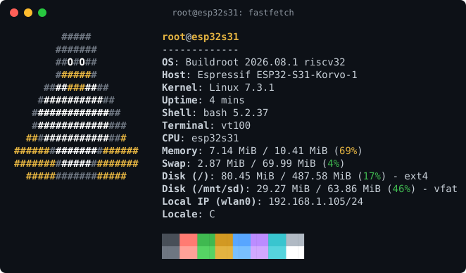

# ESP32-S31 Linux

[English](README.md) | 简体中文

> 本文译自 [README.md](README.md)。两者不同时，以英文版为准。

在乐鑫 ESP32-S31 上运行 Linux 7.3.4 和 OpenSBI 1.9。ESP32-S31 是一款微控制器，
有两个 320 MHz 的 RV32 hart 和 512 KiB SRAM。Linux 在 hart 1 上运行，使用
16 MiB 八线 PSRAM。hart 0 运行 ESP-Hosted 无线固件，提供 Wi-Fi、蓝牙和
Thread。标准内核加上一小组补丁即可启动 Buildroot 用户空间：shell、
`wpa_supplicant`、BlueZ、SSH、USB 等。

```text
ESP ROM -> ESP-IDF 2nd stage -> loader (hart 0) -> OpenSBI (hart 1) -> Linux (hart 1)
```



[docs/internals.md](docs/internals.md)（英文）说明移植的工作原理和代码位置。
[CHANGELOG.md](CHANGELOG.md)（英文）列出每个版本的更改。

## 快速开始

共有三种构建。ESP32-S31-WROOM-3-N16R16V 模组是两块开发板上使用的模组。

| 开发板 | 构建 | 根文件系统 | 发布文件 |
| --- | --- | --- | --- |
| 单独使用 ESP32-S31-WROOM-3-N16R16V 模组，任何带 UART0 的板子均可 | `esp32s31`（默认） | Flash | `*-esp32s31-flash.zip` |
| ESP32-S31-Function-CoreBoard-1 | `coreboard1` | U 盘 | `*-coreboard1-flash.zip`、`*-coreboard1-usb.img.xz` |
| ESP32-S31-Korvo-1 | `korvo1` | microSD 卡 | `*-korvo1-flash.zip`、`*-korvo1-sdcard.img.xz` |

1. 从最新的[发布版本](https://github.com/annoyedmilk/esp32-s31-linux/releases)
   下载对应开发板的文件。
2. 安装经过测试的 esptool：`pip install "esptool==5.5.0"`
   （版本见 `bootloader/esptool.version`）。
3. 连接开发板的 UART 端口。Korvo-1 上是 UART Type-C 口。Korvo-1 和
   Function-CoreBoard-1 的 USB 转串口芯片是 CP2102N，部分
   Function-CoreBoard-1 使用 CH9102X。
4. 烧录：`esptool --chip esp32s31 -p PORT -b 921600 write-flash 0x0 flash.bin`
5. 写入磁盘镜像，例如使用 balenaEtcher。磁盘上的所有数据都会丢失。
   Korvo-1：将 `*-korvo1-sdcard.img.xz` 写入 microSD 卡。
   Function-CoreBoard-1：将 `*-coreboard1-usb.img.xz` 写入 U 盘。
   然后将磁盘插入开发板。单独使用模组时不需要磁盘。
6. 在同一端口打开终端，波特率 115200。按复位键。控制台显示
   `=== ESP32-S31 Linux / Buildroot ===` 后，即以 root 身份登录。

Korvo-1 的 LCD 也显示一个控制台。连接 USB 键盘并在 `tty1` 上登录，会启动
一个 `tmux` 桌面。

### Wi-Fi

```sh
wpa_passphrase "<ssid>" "<passphrase>" >> /etc/wpa_supplicant.conf
/etc/init.d/S40wifi restart
wpa_cli status
```

对于 WPA3 和 WPA2/WPA3 网络，network 块需要 `key_mgmt=WPA-PSK SAE`、
`ieee80211w=1`，并以 `psk="..."` 的形式写入密码。配置在重启后保留。
`S40wifi` 也会读取磁盘 p1（FAT 分区）上的 `wpa_supplicant.conf`，因此没有
控制台的开发板也可以从电脑获取网络配置。

### SSH

控制台以 root 身份登录。Dropbear 只允许 root 使用密钥通过 SSH 登录。
在开发板的控制台上添加你的公钥（一行）：

```sh
mkdir -p /root/.ssh && chmod 700 /root/.ssh && echo 'ssh-ed25519 AAAA... you@host' >> /root/.ssh/authorized_keys && chmod 600 /root/.ssh/authorized_keys && sync
```

用 `ip -4 addr show wlan0` 查看地址（Function-CoreBoard-1 接网线时用
`eth0`），然后运行 `ssh root@<address>`，或使用 `ssh root@esp32s31.local`
（mDNS）。要核对主机密钥，在控制台上运行
`dropbearkey -y -f /etc/dropbear/dropbear_ed25519_host_key | tail -1`。
写入新的磁盘镜像或运行 `make sdroot` 后，开发板会生成新的主机密钥，且没有
`authorized_keys`；此时在电脑上运行 `ssh-keygen -R <address>`。自行构建时，
将密钥放入 `local-overlay/root/.ssh/authorized_keys`。

## 功能

| 功能 | `esp32s31` | `coreboard1` | `korvo1` |
| --- | --- | --- | --- |
| 根文件系统 | Flash 中的 squashfs，带可写的 UBIFS overlay | U 盘上的 ext4 | microSD 卡上的 ext4 |
| 持久化 | 所有文件：overlay 位于 Flash 中 | U 盘上的所有文件 | 卡上的所有文件 |
| Swap | zram（6 MiB） | 先 zram，再用 U 盘 p3 上的 64 MiB | 先 zram，再用卡 p3 上的 64 MiB |
| Linux 可用内存（MemTotal） | 约 11.6 MiB | 约 11.1 MiB | 10.4 MiB |
| UART 控制台（`ttyS0`），可用 `stty` 设为 9767 波特至 5 Mbaud | 是 | 是 | 是 |
| 原生 USB 口上的启动日志副本和 JTAG | 是 | 是 | 否：LCD 占用这些引脚 |
| LCD 控制台、USB 键盘、tmux 桌面、触摸（GT1151） | 否 | 否 | 是 |
| Wi-Fi station（`wlan0`）：WPA2 和 WPA3 个人版 | 是 | 是 | 是 |
| Wi-Fi 企业版（PEAP、TTLS、TLS） | 可用，未测试 | 可用，未测试 | 可用，未测试 |
| Wi-Fi 接入点：WPA2 个人版（WPA3 暂不可用），为客户端提供 DHCP | `wpa_supplicant`、`udhcpd` | `wpa_supplicant`、`hostapd`、`udhcpd` | `wpa_supplicant`、`hostapd`、`udhcpd` |
| 防火墙和 NAT（`nft`，规则在启动时加载） | 是 | 是 | 是 |
| WireGuard VPN（`wg`，客户端或服务器） | 是 | 是，另有 `wg-quick` | 是（模块），另有 `wg-quick` |
| 蓝牙（`hci0`）：BlueZ、`bluetoothctl` | 是 | 是 | 是 |
| Home Assistant 蓝牙代理（ESPHome API），通过蓝牙 LE 设置 Wi-Fi（Improv） | 是 | 是 | 是 |
| 传统 BlueZ 工具（`hciconfig`、`hcitool`） | 否 | 是 | 是 |
| Thread（IEEE 802.15.4）：用于 Matter 的 OpenThread 边界路由器，`ot-ctl`，或作为 Home Assistant 的射频 | 否 | 是 | 是 |
| 以太网（`eth0`） | 否 | 千兆 | USB 网卡 |
| USB 主机（DWC2） | 否 | 根文件系统所在的 U 盘；第二个 U 盘需手动挂载 | 键盘、鼠标、存储设备（FAT、exFAT，插入时自动挂载到 `/mnt/usb`）、以太网适配器 |
| 局域网名称（`esp32s31.local`，mDNS） | 是 | 是 | 是 |
| 内核崩溃或系统挂起后重启（软件看门狗） | 是 | 是 | 是 |
| 崩溃或挂起后保留上次启动的崩溃日志（pstore） | 是 | 是 | 是 |
| microSD | 否 | 否 | 根文件系统所在的卡 |
| RGB LED（`/sys/class/leds/rgb:status`），触发器见 `/etc/default/led` | 否 | GPIO60 | GPIO37 |
| GPIO、硬件随机数、`curl` HTTPS、SSH（Dropbear，仅密钥） | 是 | 是 | 是 |
| 用 `pinctrl` 查看引脚功能、上下拉和电平（与 Raspberry Pi 相同），GPIO 线带网络名称 | 是 | 是 | 是 |
| GPIO 中断：`gpiomon` 和 libgpiod 的边沿事件，消抖 | 是 | 是 | 是 |
| 用户空间 I2C（`/dev/i2c-N`、`i2cdetect`、`i2cget`、`i2cset`） | 否；`esp32s31.dts` 中有一个禁用的示例总线 | ESP_I2C（GPIO50/51）上的 `i2c-0`；J2 第 13、14 脚上有禁用的示例 | `i2c-0`：触摸控制器和音频编解码器 |

说明：

- Korvo-1 和 Function-CoreBoard-1 没有根磁盘时无法启动，内核会一直等待磁盘。
- `/etc/os-release` 中的 `IMAGE_VERSION` 是根文件系统的版本。引导程序在启动日志
  开头以 `App version` 打印 flash 镜像的版本。在 Korvo-1 和 Function-CoreBoard-1
  上，二者分别更新，且内核从磁盘加载模块：flash 镜像和磁盘须来自同一发布版本。
- 单独使用模组时，运行 `flash_erase /dev/mtd1 0 0` 再重启，可将根文件系统
  恢复为镜像状态。`make flash` 不写入 `data` 分区，因此更新后 overlay 保留。
- `poweroff` 使芯片进入 Deep-sleep 模式，只有复位键能再次启动它。
- Linux 以单处理器模式运行。不使用 FPU（只有 F，没有 D），因此用户空间使用
  软浮点。
- 使用 WPA3-SAE 时，第一次连接可能失败，`wpa_supplicant` 会自动重试。
- 接入点请使用 WPA2（`ap.sh`）。接入点上的 WPA3（SAE）和受保护管理帧
  （PMF）暂时还不能正常工作。station 模式不受影响。
- `hcitool lescan` 无法使用。请使用 `bluetoothctl` 和 `scan le`。
- 没有音频和摄像头驱动。

## 用户空间

| 构建 | 软件包 |
| --- | --- |
| 所有开发板 | BusyBox、Dropbear、带 CA 证书包的 OpenSSL、`wpa_supplicant`（WPA3、EAP、接入点）及 `wpa_cli` 和 `wpa_passphrase`、`iw`、`curl`、`iperf3`、libgpiod 2 工具、BlueZ（`bluetoothd`、`bluetoothctl`）、Lua、带防火墙的 `nft`、SFTP 服务器、`pinctrl`、`ble-ha`、`wg` |
| `esp32s31` 另有 | MTD 工具（`mtdinfo`、`flash_erase`） |
| `coreboard1` 和 `korvo1` 另有 | `mosquitto_pub`、`mosquitto_sub`、`hostapd`、传统 BlueZ 工具（`hciconfig`、`hcitool`）、OpenThread（`ot-daemon`、`ot-ctl`）、`thread-relay`、bash、coreutils、vim、nano、less、file、htop、fastfetch、strace、gdb 和 `gdbserver`、tcpdump、links、MicroPython、tmux、nnn、ncdu、tree、bc、sqlite3、e2fsprogs、dosfstools |
| `coreboard1` 另有 | `ethtool` |
| `korvo1` 另有 | `gpm`、`irssi`、`evtest` |

`/etc/motd` 列出入门命令。`/usr/share/examples` 中有示例脚本。

- **Wi-Fi。** `iw dev wlan0 link` 显示连接状态。
  `/usr/share/examples/wifi-scan.sh` 列出范围内的网络；在磁盘开发板上，
  `/usr/share/examples/wifi-monitor.sh [COUNT]` 显示 802.11 帧。在 Korvo-1
  上，Wi-Fi 约为 45 Mbit/s 发送、36 Mbit/s 接收。蓝牙代理扫描期间，约为
  17/21 Mbit/s（发送/接收）；Thread 射频接收期间，约为 12/17。
  `/usr/share/examples/ap.sh SSID PASSPHRASE [--nat eth0]` 在 192.168.4.1
  启动 WPA2 接入点。客户端获得 192.168.4.100 到 192.168.4.200 的地址，只能
  访问开发板；加 `--nat` 时也能访问另一个接口。
  `dumpleases -f /var/run/udhcpd.wlan0.leases` 列出租约。
  `/etc/init.d/S40wifi restart` 切回 station 模式。
- **蓝牙。** 运行 `bluetoothctl`，然后 `scan le`、`scan bredr`、`devices`。
  `/usr/share/examples/ble-scan.sh 10` 扫描 10 秒。`ble-ha`
  （`/etc/default/ble-ha`）为 Home Assistant 提供蓝牙 LE。它运行时，
  `bluetoothctl` 不能使用。`bluetoothd` 运行时，它不会启动。
  - `/usr/share/examples/ha-bluetooth.sh HA_ADDRESS` 使开发板成为蓝牙代理，
    通过 TCP 端口 6053 上的 ESPHome API 工作，之后每次开机也会启动。该 API
    没有加密：防火墙只接受来自 `BT_PROXY_ALLOW` 中主机的连接。
    `ha-bluetooth.sh off` 结束代理。
  - 当 `wpa_supplicant` 没有网络时，范围内的任何设备都可以通过蓝牙 LE 上的
    Improv Wi-Fi 为开发板设置网络。只有在 30 秒内获得地址时，开发板才会保留
    该网络。`IMPROV=no` 关闭此功能。
- **Thread**（Function-CoreBoard-1、Korvo-1）。`thread-start [eth0]` 在
  `wlan0` 或 `eth0` 上启动边界路由器；`thread-start stop` 将其停止。
  `ot-ctl dataset init new`、`ot-ctl dataset commit active`、
  `ot-ctl ifconfig up` 和 `ot-ctl thread start` 组建网络。`ot-ctl state`
  显示状态，`ot-ctl dataset active -x` 打印数据集。Thread 设备通过 NAT64
  （192.168.255.0/24）访问 IPv4 主机。把数据集交给设备的方法：
  - chip-tool：`chip-tool pairing code-thread 1 hex:DATASET SETUPCODE`。
    在 Linux PC 上，
    `sysctl -w net.ipv6.conf.IFACE.accept_ra_rt_info_max_plen=64` 提供到
    Mesh 网络的路由。
  - 手机应用：`thread-share [MINUTES]` 打印一个临时密钥，有效 1 到 10 分钟
    （默认 2 分钟）。`thread-share stop` 结束该密钥。
  - 不使用 Matter 的 Thread 设备：`ot-ctl commissioner start`，然后
    `ot-ctl commissioner joiner add * PSKD`。

  `/usr/share/examples/thread-hub.sh` 组建网络，并将 UDP 4242 端口收到的
  每个数据报记录到磁盘 p1 上。
  `/usr/share/examples/ha-thread.sh HA_ADDRESS` 通过 TCP 端口 6638 将射频
  交给 Home Assistant（`/etc/default/thread` 中的 `THREAD_MODE=relay` 和
  `RELAY_ALLOW`）。在 OpenThread Border Router 应用中，设置一个占位设备，
  并将 `network_device` 设为 `BOARD_ADDRESS:6638`。该端口可以完全控制
  射频：防火墙只接受来自 `RELAY_ALLOW` 的连接。对中继来说，以太网优于
  Wi-Fi。重新加载防火墙后，请运行 `thread-start stop` 和 `thread-start`。
  `ha-thread.sh off` 结束中继。尚未用 Home Assistant OS 的应用测试。
- **MQTT**（Function-CoreBoard-1、Korvo-1）。`mosquitto_pub` 和
  `mosquitto_sub` 收发消息，支持 TLS（端口 8883；TLS 需要正确的时间）。
  `/etc/default/mqtt`（权限 600）包含代理服务器、用户名、密码、客户端 ID
  和 CA 文件。`/usr/share/examples/mqtt-report.sh` 向 Home Assistant 发送
  传感器数据，`/usr/share/examples/mqtt-led.sh` 根据
  `esp32s31/MQTT_ID/led` 上的 `R G B` 消息设置 LED。这两个脚本尚未用
  Home Assistant 测试。
- **GPIO。** `gpiodetect`、`gpioinfo`、
  `gpioget --numeric -c gpiochip0 PIN`、`gpioset -t0 -c gpiochip0 PIN=1`、
  `/usr/share/examples/gpio.sh PIN [0|1]`。内核拒绝使用保留引脚。
  `pinctrl get 47`、`pinctrl -p get`（排针引脚）、`pinctrl funcs 8` 和
  `pinctrl set 47 op dh` 显示和设置功能、上下拉和电平。`set` 绕过内核驱动
  直接写寄存器：只用于调试。更多信息见 `pinctrl -h`。
  `/usr/share/examples/gpio-watch.sh PIN [rising|falling|both]` 打印每个
  边沿。`/usr/share/examples/button.sh PIN COMMAND` 在每次按下接到 GND 的
  按键时运行一条命令。`gpiomon -p 20ms` 忽略触点抖动。
- **I2C。** `i2cdetect -l` 列出总线，`i2cdetect -y 0` 扫描总线 0，
  `i2cget -y 0 0x48 0x00` 读取一个寄存器。只扫描你了解的总线，不要向开发板
  自带的器件写入。在 Function-CoreBoard-1 上，总线 0 是 ESP_I2C。要接排针
  J2 上的器件，在 `esp32s31_coreboard1.dts` 中把 `&i2c1` 设为
  `status = "okay"`（SDA 在第 13 脚，SCL 在第 14 脚），并加 4.7 kΩ 上拉
  电阻到 3V3。单独模组在 `esp32s31.dts` 中有一个 GPIO47 和 GPIO48 上的示例
  总线，还需要在 `linux-esp32s31.fragment` 中打开 `CONFIG_I2C`。每次修改
  都需要新内核。
- **LED**（Function-CoreBoard-1、Korvo-1）。
  `/usr/share/examples/led.sh R G B`（0 到 255）设置 WS2812：它写入
  `/sys/class/leds/rgb:status` 的 `multi_intensity` 和 `brightness`。在
  Korvo-1 上，`micropython /usr/share/examples/led.py R G B` 作用相同。
  `/etc/default/led` 中的 `LED_TRIGGER`（`heartbeat`、`timer`、
  `default-on`、带 `LED_NETDEV` 的 `netdev`、`panic`）和 `LED_COLOR` 使
  LED 显示状态。
- **网络。** 在 Korvo-1 上，USB 以太网适配器（CDC ECM 或 NCM、ASIX
  AX88179、Realtek RTL8152 或 RTL8153）成为 `eth0` 并通过 DHCP 获取地址。
  `/usr/share/examples/report.sh URL` 通过 HTTPS 发送运行时间和空闲内存。
- **WireGuard。** `/usr/share/examples/wg-setup.sh [PORT]` 生成密钥对和
  `/etc/wireguard/wg0.conf`（权限 600），并打印公钥。把对端的公钥、
  `Endpoint` 和 `AllowedIPs` 写入 `wg0.conf`（`wg setconf` 的格式：没有
  `Address`、`DNS` 或 `MTU`）。在 `/etc/default/wireguard` 中设置
  `WG=yes`、`WG_ADDRESS`、`WG_ROUTES` 和 `WG_MTU`，然后运行
  `/etc/init.d/S42wireguard restart`。`wg show` 显示握手。CPU 限制吞吐量。
- **防火墙。** `/etc/nftables.conf` 在启动时加载。开发板接受 ping、mDNS、
  SSH、DHCP 回复，以及磁盘开发板上的 Thread Mesh 流量和边界代理（UDP 49191
  和 49192）。以下端口只在对应功能运行时打开：接入点上的 DHCP（UDP 67）、
  `wg0` 的 `ListenPort`、面向 `BT_PROXY_ALLOW` 的 TCP 6053，以及面向
  `RELAY_ALLOW` 的 TCP 6638。防火墙丢弃并记录所有其他新连接。
  `nft insert rule inet filter input tcp dport 8080 accept` 打开一个端口，
  直到下次重启；在该文件中加一行可永久保留。
- **网页。** 打开端口 8080，然后
  `httpd -p 8080 -h /usr/share/examples/www` 提供一个可设置引脚和 LED 的
  网页。网页没有密码：只在可信的网络中打开该端口。
- **开机自启动。** 开发板运行磁盘 p1 上的 `autostart.sh`（Korvo-1 上为
  `/mnt/sd`，Function-CoreBoard-1 上为 `/mnt/usb`），或
  `/root/autostart.sh`。输出保存在 `/tmp/autostart.log`。
  `/usr/share/examples/autostart.sh` 是模板。
  `scp file root@<address>:/mnt/sd/` 可将文件复制到 p1。
- **Korvo-1。** `/usr/share/examples/touch.sh` 打印触摸事件。在 LCD 上的
  tmux 中：`Ctrl-b c` 打开新窗口，`Ctrl-b n` 切换到下一个窗口，`Ctrl-b %`
  和 `Ctrl-b "` 分屏，`Ctrl-b d` 退出登录。内核消息显示在 `tty2`
  （`Alt-F2`，用 `Alt-F1` 返回）。
- **恢复。** 内核崩溃 10 秒后，或用户空间停止 60 秒后，开发板自动重启
  （`/etc/init.d/S15watchdog stop` 将其关闭）。SysRq 可通过
  `/proc/sysrq-trigger` 使用：`s` 同步，`u` 以只读方式重新挂载，`b` 重启。
  崩溃或看门狗重启后，崩溃日志位于磁盘 p1 的 `crash/` 中（单独模组上为
  `/root/crash`）。复位键和断电会清除它。
- **时间。** 开发板没有 RTC。`ntpd` 使用 DHCP 提供的 NTP 服务器和
  `/etc/default/ntp` 中的 `NTP_SERVERS`（`pool.ntp.org`）；`NTP=no` 将其
  关闭。时钟为 UTC。用 `/etc/default/tz` 中的 POSIX 字符串设置本地时区，
  例如 `TZ="CST-8"`；在磁盘开发板上也可以用
  `ln -sf /usr/share/zoneinfo/Asia/Shanghai /etc/localtime`。

## 更新与兼容性

从 v1.0.0 起，同一主版本的各发布版本保持以下接口不变：`pinctrl` 命令的输出、
横幅行 `=== ESP32-S31 Linux / Buildroot ===`、`/etc/default/*` 中的名称，以及
单独模组的分区表（因此其 `data` 分区中的 overlay 在更新后保留）。更改其中任一
接口的发布版本使用新的主版本号。

更新时，烧录新发布版本的 `flash.bin`。在 Korvo-1 和 Function-CoreBoard-1 上，
还要写入同一发布版本的磁盘镜像：这会清除磁盘上的文件，请先复制。GitHub 上每个
发布版本的页面说明从上一版本更新所需的步骤。

## 已测试的硬件

本移植在 ESP32-S31-Korvo-1 上测试，芯片版本 v0.0，eFuse 块版本 v0.0
（以二级引导加载程序在启动日志中打印的为准）。不同版本可能导致行为不同。
`python -m esptool --chip esp32s31 -p PORT chip-id` 显示开发板的版本。

`esp32s31` 和 `korvo1` 构建在 Korvo-1 上测试。`coreboard1` 构建在 Korvo-1
上测试，根文件系统位于 U 盘；以太网、eFuse MAC 地址、LED 和 I2C 引脚尚未在
Function-CoreBoard-1 上测试。

| 功能 | `esp32s31` | `korvo1` | `coreboard1` |
| --- | --- | --- | --- |
| 启动、控制台、`stty`、SysRq | 已测试 | 已测试 | 在 Korvo-1 上已测试 |
| Wi-Fi station | 已测试 | 已测试 | 未测试 |
| 带 DHCP 的 Wi-Fi 接入点 | 未测试 | 未测试 | 未测试 |
| 防火墙、使用密钥的 SSH | 已测试 | 已测试 | 未测试 |
| 蓝牙、Home Assistant 蓝牙代理 | 未测试 | 已测试 | 未测试 |
| Thread 边界路由器 | 否 | 未测试 | 未测试 |
| Flash 中的可写根文件系统 | 已测试 | 否 | 否 |
| LCD、USB 键盘、触摸 | 否 | 未测试 | 否 |
| 以太网 | 否 | 未测试 | 未测试 |
| 看门狗、崩溃日志 | 已测试 | 已测试 | 未测试 |

## 从源码构建

在 macOS 主机上，构建需要：

- Homebrew 和 GNU make（`brew install make`）。
- ESP-IDF，位于 `~/esp/esp-idf`，检出到 `bootloader/esp-idf.version` 中的
  提交，并带有 `riscv32-esp-elf` 工具链、ESP-Hosted 补丁和向后移植补丁
  （`make bootloader` 会给出命令）。
- esptool，版本见 `bootloader/esptool.version`，安装在 ESP-IDF 的 Python
  环境中（`make check` 会给出命令）。
- Apple `container` CLI。Buildroot 无法在 macOS 上运行，它在
  `container/Containerfile` 构建的 Debian 镜像中运行。请先运行
  `container system start`。

```sh
git submodule update --init --recursive
make container-image
make check
make ports
make build   BOARD=korvo1
make flash   BOARD=korvo1 FLASH_PORT=/dev/cu.usbserial-XXXX
make monitor BOARD=korvo1 SERIAL_PORT=/dev/cu.usbserial-XXXX
```

- `BOARD` 选择目标板的构建：`esp32s31`（默认）、`coreboard1` 或 `korvo1`。
  输出位于 `build/<board>/`。
- `make build` 在 Mac 上构建加载程序和 OpenSBI，在容器中构建内核、rootfs
  和磁盘镜像。
- `make monitor` 复位开发板，等待启动横幅，然后作为终端保持打开。按 `Ctrl-]`
  退出。如果 `SERIAL_PORT` 的 RTS 线无法复位开发板，请设置 `RESET_PORT`。
- `make sdwrite SD_DISK=/dev/diskN` 将磁盘镜像写入卡或 U 盘。`make sdpart`
  为大容量磁盘分区。`make sdroot` 只写入根分区，用于更新。这些目标会擦除数据，
  执行前会先询问。
- `make rootfs-clean BOARD=...` 删除一个开发板的 Buildroot 输出，用于从头构建。
- `scripts/reset-monitor.py --port PORT --no-reset --success-pattern ""
  --cmd COMMAND` 在控制台上运行 shell 命令，在第一个失败的命令处停止。
- Korvo-1 的 UART 端口每次打开时开发板都会复位。
  `scripts/reset-monitor.py --port PORT --serve 2217` 让端口保持打开；然后把
  `rfc2217://localhost:2217` 用作该脚本和 `make monitor` 的端口。开发板只在
  RTS 脉冲时复位，脚本会打印从复位到启动横幅的时间。烧录前请停止该服务。
- `local-overlay/` 中的文件会放入所有构建的根目录。git 忽略这些文件。
- `make help` 显示所有目标。

在 Linux 主机上，Buildroot 无需容器即可运行：

```sh
BOARD=korvo1 scripts/ci-build.sh
```

它需要位于 `$IDF_PATH`（默认 `~/esp/esp-idf`）的 ESP-IDF，检出到
`bootloader/esp-idf.version` 中的提交，用 `scripts/patch-esp-idf.sh` 打好
补丁并安装其工具，还需要 Buildroot 的主机软件包。Flash 镜像输出到
`build/<board>/`。对于 `korvo1` 和 `coreboard1`，磁盘镜像为
`build/<board>/buildroot/sdcard.img`。

## 许可证

`LICENSE`（MIT）适用于构建系统、脚本和 rootfs 文件。其他文件带有 SPDX 头：
`bootloader/` 和 OpenSBI 平台代码为 BSD-2-Clause，
`bootloader/components/esp_hosted/` 为 Apache-2.0，`linux/` 和
`br2-external/package/esp-hosted-linux/` 为 GPL-2.0，
`shared/esp32s31-hosted-shm.h` 为 GPL-2.0 或 Apache-2.0。

补丁（`linux/patches/`、`opensbi/patches/`、`bootloader/idf-patches/`、
`br2-external/patches/` 以及 `br2-external/package/*/` 中的补丁）采用其所修改
软件的许可证。`tools/pinctrl/pinctrl.c` 为 BSD-3-Clause，版权属于 Raspberry Pi
Ltd。发布的镜像包含许多其他项目的程序：其许可证文本在同一发布版本的
`esp32s31-linux-VERSION-licenses.tar.xz` 中，源码在
`esp32s31-linux-VERSION-sources.tar` 中。
