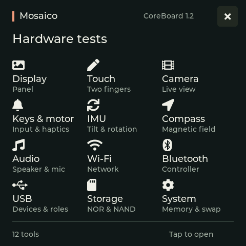
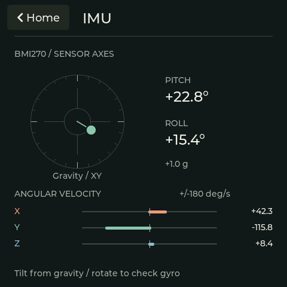
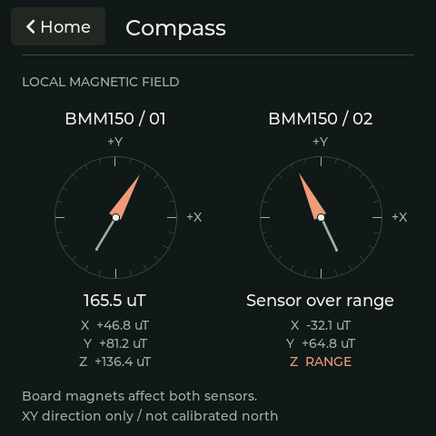

# Interface examples

These 480x480 images are rendered by the application's own LVGL code.
IMU and Compass use fixed illustrative values, not board measurements.
The second magnetic sensor demonstrates an over-range axis. The renderer
opens no hardware, plays no audio and runs no motor test.

| Home | IMU | Compass |
| --- | --- | --- |
|  |  |  |

Regenerate from the repository root using a native compiler, CMake, ALSA
development files and Python 3. The Python helper uses only the standard
library.

```sh
cmake -S applications/mosaico-test -B build/mosaico-test-examples \
  -DCMAKE_BUILD_TYPE=MinSizeRel -DMOSAICO_TEST_BUILD_EXAMPLES=ON
cmake --build build/mosaico-test-examples --target mosaico-test-examples
python3 applications/mosaico-test/examples/render.py \
  build/mosaico-test-examples/mosaico-test-examples
```

Pass `--output-dir PATH` to write images elsewhere, including when the
source checkout is read-only.

The example target is disabled by default, is host-only and is not
installed in firmware. Live sensor data remains exclusive to the normal
application; the illustrative inputs are confined to `render.c`.
